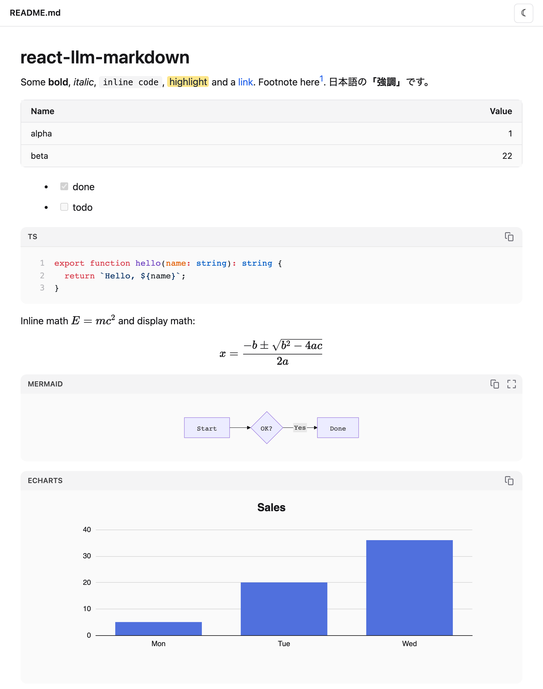
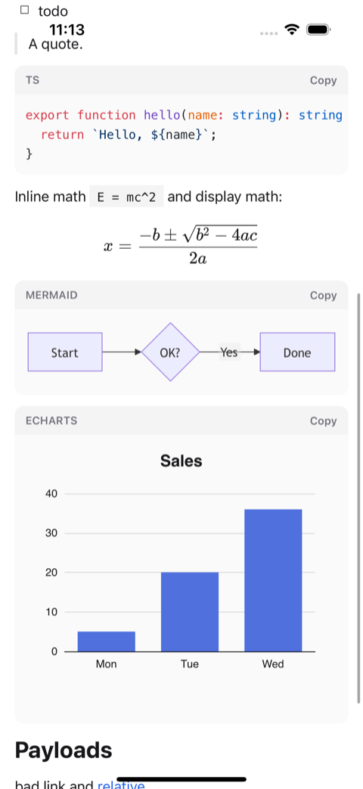
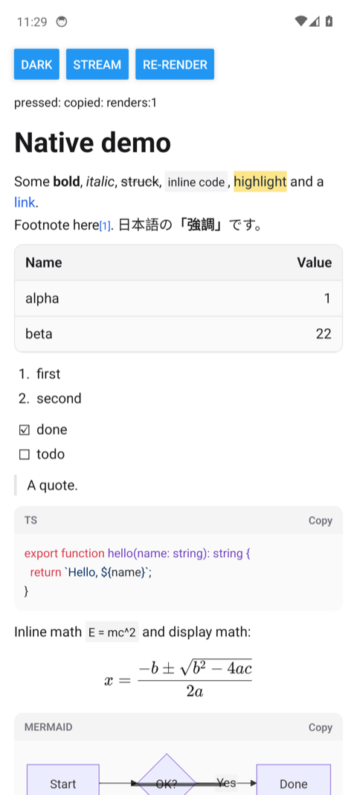

<div align="center">


# react-llm-markdown

**React と React Native のための、安全でリッチな Markdown —— LLM が書いたテキストのために作られています。**

[](https://www.npmjs.com/package/react-llm-markdown)
[](https://www.npmjs.com/package/react-llm-markdown)
[](https://github.com/mickey-ichi/react-llm-markdown/actions/workflows/ci.yml)
[](https://www.npmjs.com/package/react-llm-markdown#provenance)
[](LICENSE)

[Playground](https://mickey-ichi.github.io/react-llm-markdown/) ·
[ドキュメント](https://mickey-ichi.github.io/react-llm-markdown/ja/docs/introduction/) ·
[npm](https://www.npmjs.com/package/react-llm-markdown) ·
[変更履歴](CHANGELOG.md)

[English](README.md) · [Tiếng Việt](README.vi.md) · **日本語**

</div>

<p align="center">
  <picture>
    <source media="(prefers-color-scheme: dark)" srcset="https://raw.githubusercontent.com/mickey-ichi/react-llm-markdown/main/assets/web-dark.png">
    
  </picture>
</p>

<p align="center">
  <picture>
    <source media="(prefers-color-scheme: dark)" srcset="https://raw.githubusercontent.com/mickey-ichi/react-llm-markdown/main/assets/ios-dark.png">
    
  </picture>
  &nbsp;&nbsp;
  <picture>
    <source media="(prefers-color-scheme: dark)" srcset="https://raw.githubusercontent.com/mickey-ichi/react-llm-markdown/main/assets/android-dark.png">
    
  </picture>
  <br>
  <sub>Web · iPhone（iOS 18 シミュレーター）· Android 14 エミュレーター — E2E テストで撮影</sub>
</p>

## なぜ必要か

モデルの回答は信頼できない入力です。プロンプトインジェクションによって、スクリプトを実行したり、データを外部に送信したり、
読み手を欺いたりするように作られた HTML、リンク、ダイアグラム、チャートのオプションを返させることができます。しかも回答は
書きかけの状態でストリーミングされてきます。react-llm-markdown は、モデルが使うリッチなブロックをレンダリングし、
ストリーミング中の Markdown を補修し、それ以外のものを無害化します。Web でも React Native でも動作します。

## 機能

- **リッチなブロック** —— GFM のテーブル・タスクリスト・脚注、Shiki によるコードハイライト、KaTeX の数式、Mermaid のダイアグラム、
  JSON のフェンスから描く ECharts のチャート、CJK に対応した強調。
- **ストリーミング対応** —— 書きかけのテーブル、コードフェンス、強調も完成しているかのようにレンダリングされます。`**` がちらつくことはありません。
- **デフォルトで堅牢** —— サニタイズされた HTML、URL の許可リスト、DOM clobbering 対策、制限をかけた Mermaid と KaTeX、
  チャートのオプションに対する許可リストと上限、画像の許可リスト用フック。[実際のブラウザで 27 種類の攻撃ペイロードを使ってテストしています](https://mickey-ichi.github.io/react-llm-markdown/ja/docs/test-report/)。
- **Web と React Native** —— 1 つのパッケージ、1 つのパーサー、1 つのセキュリティルール。スマートフォンではネイティブビューを使い、
  数式・ダイアグラム・チャートはサンドボックス化された WebView で描画します。Expo Go でも動作します。
- **すぐに導入できる** —— ビルド済みでプレフィックス付きの CSS（Tailwind の設定は不要）、ライトテーマとダークテーマ、サーバーレンダリング、
  必要に応じて読み込まれるプラグイン。
- **CLI** —— `npx react-llm-markdown README.md` で任意の Markdown ファイルをブラウザで開き、ライブリロードで表示します。

## クイックスタート

### Web（React、Next.js、Vite）

```bash
npm install react-llm-markdown streamdown @streamdown/code @streamdown/math @streamdown/mermaid @streamdown/cjk echarts
```

```tsx
import { MarkdownView } from 'react-llm-markdown';
import 'react-llm-markdown/styles.css';

export function Answer({ text, done }: { text: string; done: boolean }) {
  return <MarkdownView streaming={!done}>{text}</MarkdownView>;
}
```

### React Native と Expo

```bash
npm install react-llm-markdown
npx expo install react-native-webview   # optional: math, Mermaid and charts
```

```tsx
import { WebView } from 'react-native-webview';
import { MarkdownView } from 'react-llm-markdown/native';

export function Answer({ text, done }: { text: string; done: boolean }) {
  return (
    <MarkdownView streaming={!done} webView={WebView}>
      {text}
    </MarkdownView>
  );
}
```

### 任意の Markdown ファイル

```bash
npx react-llm-markdown README.md
```

### サンプル

| | |
|---|---|
| [Next.js](https://github.com/mickey-ichi/react-llm-markdown/tree/main/examples/nextjs) | App Router のチャットページ：ルートハンドラーが回答をストリーミングし、`MarkdownView` が描画します |
| [React Native (Expo)](https://github.com/mickey-ichi/react-llm-markdown/tree/main/examples/react-native) | ストリーミングされる回答、WebView ブロック、コピーボタンを備えた 1 画面のアプリ。Expo Go で動作します |

## ドキュメント

| | |
|---|---|
| [比較](https://mickey-ichi.github.io/react-llm-markdown/ja/docs/comparison/) | react-markdown、Streamdown、React Native 向けレンダラーとの比較 |
| [スタートガイド](https://mickey-ichi.github.io/react-llm-markdown/ja/docs/getting-started/) | インストール、回答のストリーミング |
| [Web レンダラー](https://mickey-ichi.github.io/react-llm-markdown/ja/docs/web/) | props、画像、テーマ、要素の上書き、SSR |
| [React Native レンダラー](https://mickey-ichi.github.io/react-llm-markdown/ja/docs/react-native/) | props、WebView ブロック、ハイライト、リンク、セルフホスト |
| [コード・数式・ダイアグラム・チャート](https://mickey-ichi.github.io/react-llm-markdown/ja/docs/rich-blocks/) | ライブサンプルと各ブロックのルール |
| [Core API](https://mickey-ichi.github.io/react-llm-markdown/ja/docs/core/) | DOM に依存しないパーサーとセキュリティポリシー |
| [CLI ビューアー](https://mickey-ichi.github.io/react-llm-markdown/ja/docs/cli/) | オプションと安全性 |
| [FAQ](https://mickey-ichi.github.io/react-llm-markdown/ja/docs/faq/) | Tailwind、Next.js、Expo Go、オフライン、画像経由の漏えい |

## 互換性

| | 対応 |
|---|---|
| React | 18、19 |
| React Native | 0.74 以降（Expo SDK 51+、Expo Go） |
| フレームワーク | Next.js（App Router と Pages）、Vite、Remix、その他あらゆる React 環境 |
| TypeScript | 型定義を同梱。`bundler`、`node16`、`node10` の解決方式に対応 |
| Node.js（CLI） | 20 以降 |
| テスト環境 | Chromium（Web と React Native Web）、変更ごとに [iOS 18 シミュレーターと Android 14 エミュレーター](https://github.com/mickey-ichi/react-llm-markdown/actions/workflows/native-device.yml) |

## セキュリティ

信頼できない Markdown は、スクリプトを実行することも、許可していないホストから読み込むことも、ページを遷移させることもできません。
HTML、URL、Mermaid、KaTeX、ECharts、React Native の WebView を含む完全なポリシーは
[docs/security.md](https://mickey-ichi.github.io/react-llm-markdown/ja/docs/security/) にあり、すべてのルールはエンドツーエンドで検証されています
（[テストレポート](https://mickey-ichi.github.io/react-llm-markdown/ja/docs/test-report/)）。

他のレンダラーと同様に、デフォルトでは任意の http(s) ホストの画像が読み込まれます。自分のホストだけを許可するには `isImageAllowed` を渡してください。

脆弱性を見つけた場合は、非公開で報告してください。詳しくは [SECURITY.md](SECURITY.md) をご覧ください。

## コントリビュート

バグ報告、ドキュメントの修正、プルリクエストを歓迎します。[CONTRIBUTING.md](CONTRIBUTING.md) と
[行動規範](CODE_OF_CONDUCT.md) をご覧ください。

## サポート

react-llm-markdown が時間の節約に役立っているなら、[GitHub Sponsors](https://github.com/sponsors/mickey-ichi)
を通じて開発を支援できます。バグ報告やプルリクエストも同じように歓迎します。

## ライセンス

[MIT](LICENSE) © mickey-ichi。CLI ビューアーにはサードパーティのパッケージが同梱されており、それらのライセンスは
`dist/viewer/THIRD_PARTY_LICENSES.txt` に含まれています。
