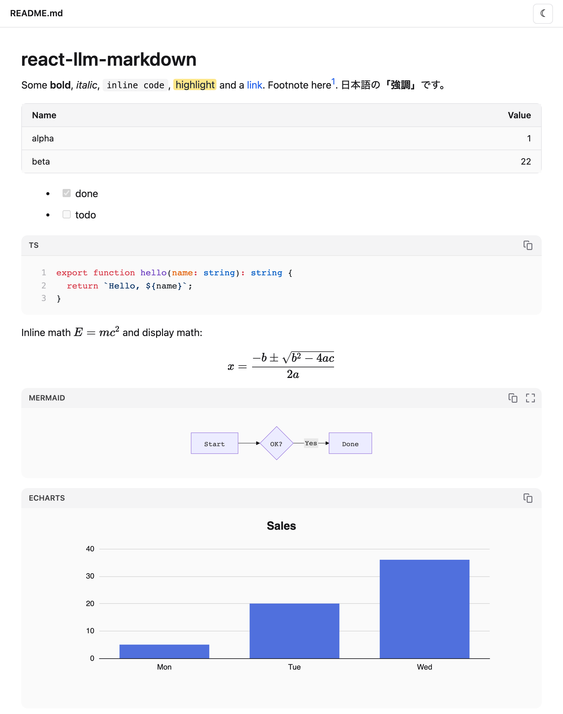
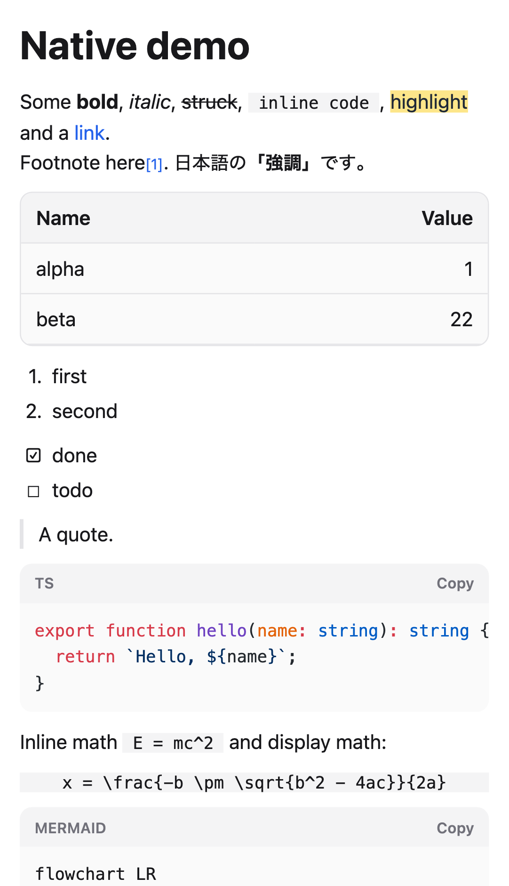

<p align="center"></p>

# react-llm-markdown

[](https://www.npmjs.com/package/react-llm-markdown) [](https://github.com/mickey-ichi/react-llm-markdown/actions/workflows/ci.yml)

**[Try it in the playground →](https://mickey-ichi.github.io/react-llm-markdown/)** — paste or stream Markdown and
see it rendered on the web and in React Native side by side, attack payloads included.

Safe, rich Markdown for **React and React Native** — built for text an LLM wrote — plus a CLI that shows any `.md` file
in your browser.

- **Rich blocks**: GFM (tables, task lists, footnotes), syntax highlighting (Shiki), math (KaTeX), Mermaid diagrams,
  ECharts charts from a JSON fence, CJK-aware emphasis.
- **Streaming**: repairs half-written Markdown while an answer streams in, so a table or code fence never breaks the layout.
- **LLM habits handled**: `\( … \)` / `\[ … \]` math, a single newline as a line break (chat style, optional).
- **Hardened by default**: raw HTML sanitized, a URL protocol allowlist, locked-down Mermaid and KaTeX, and an
  allowlist + size limits for chart options. Untrusted model output cannot run script.
- **Light by default**: the heavy parts load on demand in the browser; on the server it renders plain Markdown.
- **Drop-in styles**: one CSS file, no Tailwind needed in your app, and its classes are prefixed (`rlm:`) so they never
  clash with yours. Light and dark themes.

<p align="center">
  <picture>
    <source media="(prefers-color-scheme: dark)" srcset="https://raw.githubusercontent.com/mickey-ichi/react-llm-markdown/main/assets/web-dark.png">
    
  </picture>
  &nbsp;
  <picture>
    <source media="(prefers-color-scheme: dark)" srcset="https://raw.githubusercontent.com/mickey-ichi/react-llm-markdown/main/assets/native-dark.png">
    
  </picture>
</p>
<p align="center"><sub>Web (left) and React Native (right, the <a href="example/">example app</a>). On a device, math, Mermaid and charts
draw in a WebView; this capture is the web build of the app, which shows their source.</sub></p>

One package, three entry points:

| Import | For |
|---|---|
| `react-llm-markdown` / `react-llm-markdown/web` | React on the web (built on [Streamdown](https://streamdown.ai)) |
| `react-llm-markdown/native` | React Native and Expo (native views; WebView for math, Mermaid, charts) |
| `react-llm-markdown/core` | The DOM-free part both share: parsing to mdast, streaming repair, the security policies |

On React Native, `import … from 'react-llm-markdown'` resolves to the native entry by itself (the `react-native` export
condition).

## View a Markdown file

```bash
npx react-llm-markdown README.md
```

Opens the file in your browser and reloads it whenever you save. Pass a folder to open its `README.md`. Relative images
and links to other `.md` files in the same folder work. Options: `--port <n>`, `--no-open`.

The viewer listens on `127.0.0.1` only and serves files from the document's folder only (never dotfiles such as `.env`).

## Use it in React (web)

```bash
npm install react-llm-markdown streamdown @streamdown/code @streamdown/math @streamdown/mermaid @streamdown/cjk echarts
```

The web renderer's libraries are peer dependencies, so a React Native app never installs them.

```tsx
import { MarkdownView } from 'react-llm-markdown';
import 'react-llm-markdown/styles.css';

export function Answer({ text, done }: { text: string; done: boolean }) {
  return <MarkdownView streaming={!done}>{text}</MarkdownView>;
}
```

Works with React 18 and 19, in Next.js (App Router: it is a client component), Vite and others.

### Props

| Prop | Default | |
|---|---|---|
| `children` | — | The Markdown source. |
| `streaming` | `false` | `true` while text is still arriving: repairs incomplete Markdown and fades new words in. |
| `features` | all on | `{ code, math, mermaid, echarts, cjk }` — set one to `false` to never load it. |
| `softBreaks` | `true` | A single newline becomes a line break, as in chat. `false` for standard Markdown. |
| `className` | — | Extra class on the wrapper `<div class="rlm-markdown">`. |
| `components` | — | Element overrides, merged over the built-in safe link and image components. |

## Use it in React Native

```bash
npm install react-llm-markdown
npx expo install react-native-webview   # optional: math, Mermaid and charts
```

```tsx
import * as Clipboard from 'expo-clipboard';
import { WebView } from 'react-native-webview';
import { MarkdownView } from 'react-llm-markdown/native';

export function Answer({ text, done }: { text: string; done: boolean }) {
  return (
    <MarkdownView streaming={!done} webView={WebView} onCopyCode={(code) => Clipboard.setStringAsync(code)}>
      {text}
    </MarkdownView>
  );
}
```

Works in Expo (Go and dev builds) and bare React Native: plain JavaScript, no native module of its own.

- Drawn with native views: headings, paragraphs, emphasis, links, images, lists and task lists, quotes, tables
  (horizontal scroll), footnotes, inline code and code blocks highlighted with Shiki (JavaScript regex engine, no
  WebAssembly; bundled grammars: JS/TS/JSX/TSX, JSON, shell, Python, HTML, CSS, SQL, YAML, diff).
- In a WebView, when you pass `webView`: display math (KaTeX, with its stylesheet and fonts; offline it falls back to
  MathML), Mermaid and ECharts. Scripts and the stylesheet load from pinned jsDelivr URLs with Subresource Integrity —
  set `scripts` to self-host. Without `webView`, those blocks show their
  source. Inline math shows its source.
- Raw HTML is never rendered as HTML; only its text is shown (`<mark>`, `<sub>`, `<sup>`, `<br>` are honored).

| Prop | Default | |
|---|---|---|
| `children` | — | The Markdown source. |
| `streaming` | `false` | `true` while text is still arriving: incomplete Markdown is repaired. |
| `webView` | — | `WebView` from `react-native-webview`, to draw math, Mermaid and charts. |
| `features` | all on | `{ code, math, mermaid, echarts, cjk }` — `false` turns one off. |
| `softBreaks` | `true` | A single newline becomes a line break. |
| `colorScheme` | device | `'light'` or `'dark'`. |
| `theme` | — | Override colors and sizes (`foreground`, `link`, `card`, `fontSize`, `chartHeight`, …). |
| `baseUrl` | — | Resolves relative links and images; without it they do not open or load. |
| `onLinkPress` | — | Called with the URL; return `false` to stop opening it in the browser. |
| `onCopyCode` | — | Shows a Copy button on code blocks. |
| `highlighter` | Shiki | A custom `(code, lang, scheme) => lines` or `false`. `createCodeHighlighter([...grammars])` adds languages from `@shikijs/langs`. |
| `scripts` | jsDelivr | `{ mermaid, echarts, katex }`: `{ url, integrity }` of what the WebViews load. |

### Charts

A fence tagged `echarts` (or `chart`) whose body is an ECharts option in JSON is drawn as a chart:

````markdown
```echarts
{ "xAxis": { "type": "category", "data": ["Mon", "Tue", "Wed"] },
  "yAxis": { "type": "value" },
  "series": [{ "type": "bar", "data": [5, 20, 36] }] }
```
````

JSON only (no functions). Options outside the allowlist (for example `graphic`, `toolbox`, `custom` series), HTML in
strings, image URLs and links are removed; an option over 50 series or 20,000 data points shows its JSON instead. The
chart follows the light/dark theme.

### Theme

Dark mode follows a `dark` class or `data-theme="dark"` on an ancestor (usually `<html>`). Colors are CSS variables you
can override:

```css
:root {
  --rlm-link: #7c3aed;
  --rlm-card: #f8fafc;
  --rlm-chart-height: 400px;
}
```

Tokens: `--rlm-background`, `--rlm-foreground`, `--rlm-muted`, `--rlm-muted-foreground`, `--rlm-border`, `--rlm-card`,
`--rlm-primary`, `--rlm-primary-foreground`, `--rlm-sidebar`, `--rlm-ring`, `--rlm-link`, `--rlm-chart-height`.
With shadcn/ui, map them to your theme, e.g. `--rlm-background: hsl(var(--background));`.

## Security

Markdown from a model or a user is treated as untrusted:

- Raw HTML is parsed, then sanitized: no `<script>`, `<iframe>`, `<style>`, event handlers or `<picture>` sources.
  Extra tags allowed: `br`, `sub`, `sup`, `mark`, `details`, `summary`.
- Links and images: `http:`, `https:`, `mailto:` and relative URLs only — `javascript:`, `data:`, `file:` and
  protocol-relative `//host` are dropped. External links open in a new tab with `rel="noopener noreferrer nofollow"`
  and no referrer; images load lazily with no referrer.
- Mermaid runs with `securityLevel: 'strict'` and no HTML labels; `%%{init}%%` directives and frontmatter config in a
  diagram are removed, and a source over 50,000 characters is refused.
- KaTeX runs with `trust: false`, `maxExpand: 1000` and `maxSize: 20`.
- ECharts options: see [Charts](#charts).
- React Native WebViews: a strict Content-Security-Policy (scripts only from the pinned origin, with SRI), content
  passed as escaped JSON, no navigation away from the document, no file access, no new windows.

The policy functions are exported for reuse (from any entry, or `react-llm-markdown/core`): `parseMarkdown`,
`prepareMarkdown`, `sanitizeMarkdownUrl`, `hardenEChartsOption`, `parseEChartsSource`,
`stripMermaidConfigOverrides`, `normalizeLatexDelimiters`, `remarkSoftBreaks`, and the constants behind them.

### Tested in a real browser

Every rule is checked end to end in Chromium on the web renderer, the React Native renderer and the WebView documents:
24 attack payloads (scripts, event handlers, dangerous URLs, chart, diagram and math tricks) must not run anything, load
anything from the attacker's host or navigate away, and five performance cases must stay within budget (rendered in
5 s, typing still responsive within 0.5 s, no slowdown or memory growth on repeat).

- [docs/security.md](docs/security.md) — the policies, component by component
- [docs/performance.md](docs/performance.md) — budgets, method and results
- [docs/test-report.md](docs/test-report.md) — the latest run, case by case (generated by `npm run docs:report`)

Report a vulnerability privately: see [SECURITY.md](SECURITY.md).

## Development

```bash
npm install
npm run build      # dist/: library, styles.css, CLI and viewer bundle
npm test
npm run view -- path/to/file.md
npx playwright install chromium   # once
npm run e2e        # end to end in Chromium: web viewer, React Native renderer, WebView documents
```

The React Native end-to-end tests run the [example Expo app](example/) built for the web (react-native-web): the
native renderer and Shiki run for real, while `react-native-webview` (which has no web version) is covered by loading
its documents directly. Try the app on a phone with `cd example && npm install && npx expo start` and Expo Go.

Node.js >= 22.18 for development (tests run TypeScript directly; React Native primitives are stubbed in
`test/stubs/`); the published package needs Node.js >= 20 for the CLI.

## License

[MIT](LICENSE). The CLI viewer bundles third-party packages; their licenses are in
`dist/viewer/THIRD_PARTY_LICENSES.txt` of the published package.
