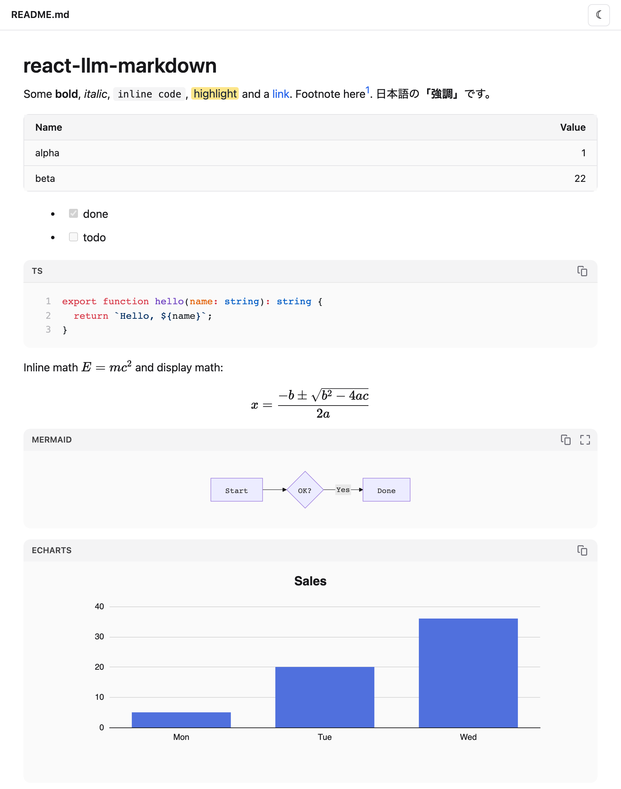
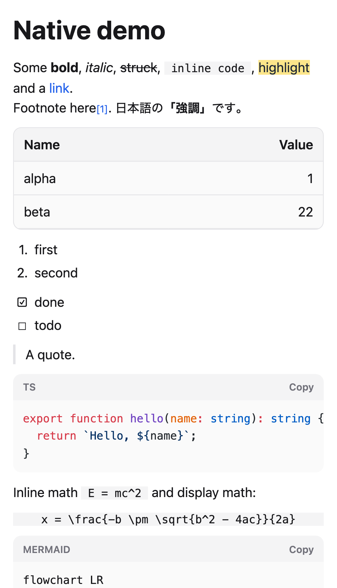

<div align="center">


# react-llm-markdown

**Markdown an toàn và đầy đủ tính năng cho React và React Native — dành cho văn bản do LLM viết.**

[](https://www.npmjs.com/package/react-llm-markdown)
[](https://www.npmjs.com/package/react-llm-markdown)
[](https://github.com/mickey-ichi/react-llm-markdown/actions/workflows/ci.yml)
[](https://www.npmjs.com/package/react-llm-markdown#provenance)
[](LICENSE)

[Playground](https://mickey-ichi.github.io/react-llm-markdown/) ·
[Tài liệu](https://mickey-ichi.github.io/react-llm-markdown/vi/docs/introduction/) ·
[npm](https://www.npmjs.com/package/react-llm-markdown) ·
[Changelog](CHANGELOG.md)

[English](README.md) · **Tiếng Việt** · [日本語](README.ja.md)

</div>

<p align="center">
  <picture>
    <source media="(prefers-color-scheme: dark)" srcset="https://raw.githubusercontent.com/mickey-ichi/react-llm-markdown/main/assets/web-dark.png">
    
  </picture>
  &nbsp;
  <picture>
    <source media="(prefers-color-scheme: dark)" srcset="https://raw.githubusercontent.com/mickey-ichi/react-llm-markdown/main/assets/native-dark.png">
    
  </picture>
</p>

## Tại sao

Câu trả lời của model là input không đáng tin cậy. Một prompt injection có thể khiến model trả về HTML, link, sơ đồ hay
cấu hình biểu đồ được dựng sẵn để chạy script, gửi dữ liệu ra ngoài hoặc đánh lừa người đọc — và nội dung đó stream về
khi còn đang viết dở. react-llm-markdown render các khối nội dung phong phú (rich block) mà model hay dùng, sửa Markdown
ngay trong lúc stream, và vô hiệu hoá phần còn lại, trên web lẫn React Native.

## Tính năng

- **Rich block** — bảng GFM, task list và footnote, tô màu code bằng Shiki, công thức toán KaTeX, sơ đồ Mermaid,
  biểu đồ ECharts từ một fence JSON, nhấn mạnh (emphasis) hiểu đúng văn bản CJK.
- **Sẵn sàng cho streaming** — bảng, code fence và emphasis viết dở vẫn render như đã hoàn chỉnh; không còn `**` nhấp nháy.
- **An toàn mặc định** — HTML được sanitize, allowlist cho URL, chống DOM clobbering, Mermaid và KaTeX bị khoá chặt,
  allowlist và giới hạn cho cấu hình biểu đồ, hook allowlist cho ảnh. [Đã kiểm thử với 27 payload tấn công trên trình duyệt thật](https://mickey-ichi.github.io/react-llm-markdown/vi/docs/test-report/).
- **Web và React Native** — một package, một parser và một bộ quy tắc bảo mật; view native trên điện thoại, còn
  công thức toán, sơ đồ và biểu đồ chạy trong WebView sandbox. Chạy được trong Expo Go.
- **Dùng ngay** — CSS build sẵn, có tiền tố (không cần cài Tailwind), theme sáng và tối, server rendering, plugin được
  tải khi cần.
- **CLI** — `npx react-llm-markdown README.md` mở bất kỳ file Markdown nào trên trình duyệt, tự tải lại khi file thay đổi.

## Bắt đầu nhanh

### Web (React, Next.js, Vite)

```bash
npm install react-llm-markdown streamdown @streamdown/code @streamdown/math @streamdown/mermaid @streamdown/cjk echarts
```

```tsx
import { MarkdownView } from 'react-llm-markdown';
import 'react-llm-markdown/styles.css';

export function Answer({ text, done }: { text: string; done: boolean }) {
  return <MarkdownView streaming={!done}>{text}</MarkdownView>;
}
```

### React Native và Expo

```bash
npm install react-llm-markdown
npx expo install react-native-webview   # optional: math, Mermaid and charts
```

```tsx
import { WebView } from 'react-native-webview';
import { MarkdownView } from 'react-llm-markdown/native';

export function Answer({ text, done }: { text: string; done: boolean }) {
  return (
    <MarkdownView streaming={!done} webView={WebView}>
      {text}
    </MarkdownView>
  );
}
```

### Bất kỳ file Markdown nào

```bash
npx react-llm-markdown README.md
```

### Ví dụ

| | |
|---|---|
| [Next.js](https://github.com/mickey-ichi/react-llm-markdown/tree/main/examples/nextjs) | Trang chat App Router: route handler stream câu trả lời, `MarkdownView` render nó |
| [React Native (Expo)](https://github.com/mickey-ichi/react-llm-markdown/tree/main/examples/react-native) | Một màn hình với câu trả lời được stream, khối WebView và nút Copy; chạy trong Expo Go |

## Tài liệu

| | |
|---|---|
| [So sánh](https://mickey-ichi.github.io/react-llm-markdown/vi/docs/comparison/) | Đặt cạnh react-markdown, Streamdown và các renderer cho React Native |
| [Bắt đầu](https://mickey-ichi.github.io/react-llm-markdown/vi/docs/getting-started/) | Cài đặt, stream một câu trả lời |
| [Renderer cho web](https://mickey-ichi.github.io/react-llm-markdown/vi/docs/web/) | Prop, ảnh, theme, ghi đè element, SSR |
| [Renderer cho React Native](https://mickey-ichi.github.io/react-llm-markdown/vi/docs/react-native/) | Prop, khối WebView, tô màu code, link, tự host |
| [Code, công thức toán, sơ đồ, biểu đồ](https://mickey-ichi.github.io/react-llm-markdown/vi/docs/rich-blocks/) | Ví dụ trực tiếp và quy tắc cho từng loại khối |
| [Core API](https://mickey-ichi.github.io/react-llm-markdown/vi/docs/core/) | Parser không phụ thuộc DOM và các chính sách bảo mật |
| [CLI viewer](https://mickey-ichi.github.io/react-llm-markdown/vi/docs/cli/) | Tuỳ chọn và an toàn |
| [FAQ](https://mickey-ichi.github.io/react-llm-markdown/vi/docs/faq/) | Tailwind, Next.js, Expo Go, offline, rò rỉ qua ảnh |

## Tương thích

| | Hỗ trợ |
|---|---|
| React | 18, 19 |
| React Native | 0.74 trở lên (Expo SDK 51+, Expo Go) |
| Framework | Next.js (App Router và Pages), Vite, Remix, mọi thiết lập React |
| TypeScript | Có sẵn type; resolution `bundler`, `node16` và `node10` |
| Node.js (CLI) | 20 trở lên |

## Bảo mật

Markdown không đáng tin cậy không thể chạy script, tải tài nguyên từ host bạn chưa cho phép, hay điều hướng trang.
Toàn bộ chính sách — HTML, URL, Mermaid, KaTeX, ECharts và WebView trên React Native — nằm trong
[docs/security.md](https://mickey-ichi.github.io/react-llm-markdown/vi/docs/security/), và mọi quy tắc đều được kiểm tra end to end
([báo cáo kiểm thử](https://mickey-ichi.github.io/react-llm-markdown/vi/docs/test-report/)).

Mặc định, ảnh từ bất kỳ host http(s) nào đều được tải, giống các renderer khác; truyền `isImageAllowed` để chỉ cho phép host của bạn.

Phát hiện lỗ hổng? Vui lòng báo cáo riêng — xem [SECURITY.md](SECURITY.md).

## Đóng góp

Rất hoan nghênh báo lỗi, sửa tài liệu và pull request. Xem [CONTRIBUTING.md](CONTRIBUTING.md) và
[Quy tắc ứng xử](CODE_OF_CONDUCT.md).

## Ủng hộ

Nếu react-llm-markdown giúp bạn tiết kiệm thời gian, bạn có thể ủng hộ việc phát triển qua
[GitHub Sponsors](https://github.com/sponsors/mickey-ichi). Báo lỗi và pull request cũng được hoan nghênh không kém.

## Giấy phép

[MIT](LICENSE) © mickey-ichi. CLI viewer có đóng gói kèm các package bên thứ ba; giấy phép của chúng nằm trong
`dist/viewer/THIRD_PARTY_LICENSES.txt`.
