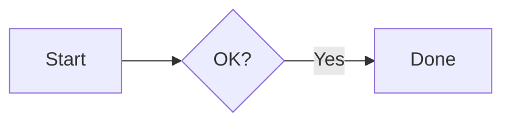
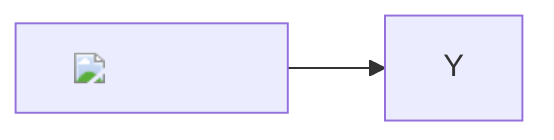

# react-llm-markdown

Some **bold**, _italic_, `inline code`, <mark>highlight</mark> and a [link](https://example.com).
Footnote here[^1]. 日本語の**「強調」**です。

| Name | Value |
|---|---:|
| alpha | 1 |
| beta | 22 |

- [x] done
- [ ] todo

```ts
export function hello(name: string): string {
  return `Hello, ${name}`;
}
```

Inline math \( E = mc^2 \) and display math:

\[ x = \frac{-b \pm \sqrt{b^2 - 4ac}}{2a} \]



```echarts
{"title":{"text":"Sales"},"tooltip":{"formatter":"{b}"},"xAxis":{"type":"category","data":["Mon","Tue","Wed"]},"yAxis":{"type":"value"},"series":[{"type":"bar","data":[5,20,36]}]}
```


[Other page](./other.md)

## Payloads


<script>window.__pwned='script'</script>

[bad link](javascript:window.__pwned='link')

$$\href{javascript:window.__pwned='katex'}{click}$$



[^1]: The footnote.
