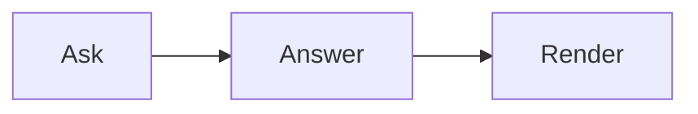

# コード、数式、ダイアグラム、チャート

4 つとも Web と React Native で同じように動作します（React Native では数式・ダイアグラム・チャートに `webView` が必要です）。
いずれも `features` で無効にできます。例：`features={{ echarts: false }}`

## コード

フェンスで囲まれたコードは Shiki（github-light / github-dark）でハイライトされ、言語名とコピーボタンを含むヘッダーが付きます。

````markdown live
```ts
export const answer = 42;
```
````

## 数式

モデルと同じ書き方で数式を書けます。インラインは `\( … \)`、ディスプレイは `\[ … \]`、あるいは `$$` を使います。

````markdown live
面積は \( A = \pi r^2 \) です。

\[ \int_0^\infty e^{-x^2} \, dx = \frac{\sqrt{\pi}}{2} \]
````

単独の `$` は数式として扱われないため、「$5 and $10」のような価格はテキストのままです。本文中のエスケープされた角括弧（`\[this\]`）や
コードはそのまま残ります。KaTeX は `trust: false` で動作するため、`\href`、`\includegraphics`、`\htmlClass` はエラーとして表示されます。

## ダイアグラム

`mermaid` のフェンスはダイアグラムになります。フローチャート、シーケンス図、状態遷移図、ER 図、ガントチャート、マインドマップに対応しています。

````markdown live

````

Mermaid は `securityLevel: 'strict'` とテキストラベルで動作します。`%%{init}%%` ディレクティブとフロントマターの `config` は
削除されるため、ダイアグラムからこれを無効にすることはできません。ストリーミング中、ダイアグラムは完成するまでソースのまま表示されます。

## チャート

`echarts`（または `chart`）というタグが付き、JSON で書かれた ECharts のオプションを含むフェンスはチャートになります。

````markdown live
```echarts
{ "xAxis": { "type": "category", "data": ["Mon", "Tue", "Wed"] },
  "yAxis": { "type": "value" },
  "series": [{ "type": "bar", "data": [5, 20, 36] }] }
```
````

- **JSON のみ** —— 関数は使えません。JavaScript、`null`、配列はソースとして表示されます。
- **許可されるオプション**：`title`、`legend`、`grid`、各種軸、`polar`、`radar`、`singleAxis`、`parallel`、`calendar`、
  `dataZoom`、`visualMap`、`tooltip`、`axisPointer`、`dataset`、`series`、色、`textStyle`、アニメーション、`darkMode`、
  `aria`。それ以外（`graphic`、`toolbox`、`geo` など）は削除されます。
- **許可されるシリーズ**：`line`、`bar`、`pie`、`scatter`、`effectScatter`、`radar`、`funnel`、`gauge`、`heatmap`、
  `boxplot`、`candlestick`、`treemap`、`sunburst`、`sankey`、`graph`、`tree`、`parallel`、`themeRiver`。
- **削除されるもの**：リンク、画像、`url()` の値、追加の CSS、文字列内の HTML。ツールチップは強制的にリッチテキストになります。
- **上限**：1,000,000 文字、50 シリーズ、20,000 データポイント。`splitNumber` は最大 100。上限を超えると、代わりにソースが表示されます。
- **大量のデータ**：2,000 ポイントを超える折れ線シリーズは、オプションで別途指定しない限り、シンボルやアニメーションなしでサンプリング（LTTB）されます。
  これにより応答性が保たれます。

チャートはライト／ダークテーマに従います。オプション自体で指定した色が優先されます。
