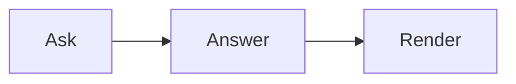

# Code, math, diagrams and charts

All four work the same on the web and in React Native (where math, diagrams and charts need `webView`). Turn any of them
off with `features`, e.g. `features={{ echarts: false }}`.

## Code

Fenced code is highlighted with Shiki (github-light / github-dark) and gets a header with the language and a copy
button.

````markdown live
```ts
export const answer = 42;
```
````

## Math

Write math the way models do — `\( … \)` inline and `\[ … \]` for display — or with `$$`:

````markdown live
The area is \( A = \pi r^2 \).

\[ \int_0^\infty e^{-x^2} \, dx = \frac{\sqrt{\pi}}{2} \]
````

A single `$` is never math, so prices like "$5 and $10" stay text. Escaped brackets in prose (`\[this\]`) and code are
left alone. KaTeX runs with `trust: false`: `\href`, `\includegraphics` and `\htmlClass` render as errors.

## Diagrams

A `mermaid` fence becomes a diagram — flowcharts, sequence, state, ER, Gantt, mind maps:

````markdown live

````

Mermaid runs with `securityLevel: 'strict'` and text labels; `%%{init}%%` directives and frontmatter `config` are
removed, so a diagram cannot switch that off. While streaming, the diagram shows its source until it is complete.

## Charts

A fence tagged `echarts` (or `chart`) holding an ECharts option in JSON becomes a chart:

````markdown live
```echarts
{ "xAxis": { "type": "category", "data": ["Mon", "Tue", "Wed"] },
  "yAxis": { "type": "value" },
  "series": [{ "type": "bar", "data": [5, 20, 36] }] }
```
````

- **JSON only** — no functions. JavaScript, `null` or an array shows as source.
- **Allowed options**: `title`, `legend`, `grid`, axes, `polar`, `radar`, `singleAxis`, `parallel`, `calendar`,
  `dataZoom`, `visualMap`, `tooltip`, `axisPointer`, `dataset`, `series`, colors, `textStyle`, animation, `darkMode`,
  `aria`. Anything else (`graphic`, `toolbox`, `geo`, …) is dropped.
- **Allowed series**: `line`, `bar`, `pie`, `scatter`, `effectScatter`, `radar`, `funnel`, `gauge`, `heatmap`,
  `boxplot`, `candlestick`, `treemap`, `sunburst`, `sankey`, `graph`, `tree`, `parallel`, `themeRiver`.
- **Removed**: links, images, `url()` values, extra CSS, HTML in strings; tooltips are forced to rich text.
- **Limits**: 1,000,000 characters, 50 series, 20,000 data points; `splitNumber` at most 100. Over a limit the source
  is shown instead.
- **Big data**: a line series over 2,000 points is sampled (LTTB) without symbols or animation, unless the option says
  otherwise — it stays responsive.

The chart follows the light/dark theme; colors the option sets itself win.
