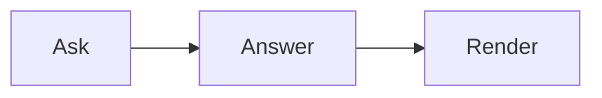

# Code, công thức toán, sơ đồ và biểu đồ

Cả bốn loại hoạt động giống nhau trên web và trong React Native (nơi công thức toán, sơ đồ và biểu đồ cần `webView`).
Tắt loại nào cũng được bằng `features`, ví dụ `features={{ echarts: false }}`.

## Code

Code trong fence được tô màu bằng Shiki (github-light / github-dark) và có một header hiển thị ngôn ngữ kèm nút copy.

````markdown live
```ts
export const answer = 42;
```
````

## Công thức toán

Viết công thức theo cách model hay viết — `\( … \)` cho inline và `\[ … \]` cho display — hoặc dùng `$$`:

````markdown live
Diện tích là \( A = \pi r^2 \).

\[ \int_0^\infty e^{-x^2} \, dx = \frac{\sqrt{\pi}}{2} \]
````

Một dấu `$` đơn lẻ không bao giờ là công thức toán, nên giá tiền như "$5 and $10" vẫn là chữ. Dấu ngoặc được escape
trong văn bản (`\[this\]`) và trong code được giữ nguyên. KaTeX chạy với `trust: false`: `\href`, `\includegraphics` và
`\htmlClass` được render thành lỗi.

## Sơ đồ

Một fence `mermaid` trở thành sơ đồ — flowchart, sequence, state, ER, Gantt, mind map:

````markdown live

````

Mermaid chạy với `securityLevel: 'strict'` và nhãn dạng text; các directive `%%{init}%%` và `config` trong frontmatter bị
loại bỏ, nên một sơ đồ không thể tắt các thiết lập đó. Trong lúc streaming, sơ đồ hiển thị mã nguồn cho đến khi hoàn chỉnh.

## Biểu đồ

Một fence gắn tag `echarts` (hoặc `chart`) chứa option ECharts dạng JSON sẽ trở thành biểu đồ:

````markdown live
```echarts
{ "xAxis": { "type": "category", "data": ["Mon", "Tue", "Wed"] },
  "yAxis": { "type": "value" },
  "series": [{ "type": "bar", "data": [5, 20, 36] }] }
```
````

- **Chỉ JSON** — không có function. JavaScript, `null` hoặc một mảng sẽ hiển thị dưới dạng mã nguồn.
- **Option được phép**: `title`, `legend`, `grid`, các trục, `polar`, `radar`, `singleAxis`, `parallel`, `calendar`,
  `dataZoom`, `visualMap`, `tooltip`, `axisPointer`, `dataset`, `series`, màu sắc, `textStyle`, animation, `darkMode`,
  `aria`. Mọi thứ khác (`graphic`, `toolbox`, `geo`, …) bị bỏ đi.
- **Series được phép**: `line`, `bar`, `pie`, `scatter`, `effectScatter`, `radar`, `funnel`, `gauge`, `heatmap`,
  `boxplot`, `candlestick`, `treemap`, `sunburst`, `sankey`, `graph`, `tree`, `parallel`, `themeRiver`.
- **Bị loại bỏ**: link, ảnh, giá trị `url()`, CSS bổ sung, HTML trong chuỗi; tooltip bị ép về rich text.
- **Giới hạn**: 1.000.000 ký tự, 50 series, 20.000 điểm dữ liệu; `splitNumber` tối đa 100. Vượt giới hạn thì hiển thị mã
  nguồn thay vì biểu đồ.
- **Dữ liệu lớn**: một line series trên 2.000 điểm sẽ được lấy mẫu (LTTB), không có symbol hay animation, trừ khi option
  quy định khác — nhờ vậy biểu đồ vẫn mượt.

Biểu đồ theo theme sáng/tối; màu do chính option đặt sẽ được ưu tiên.
